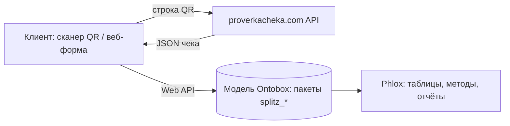
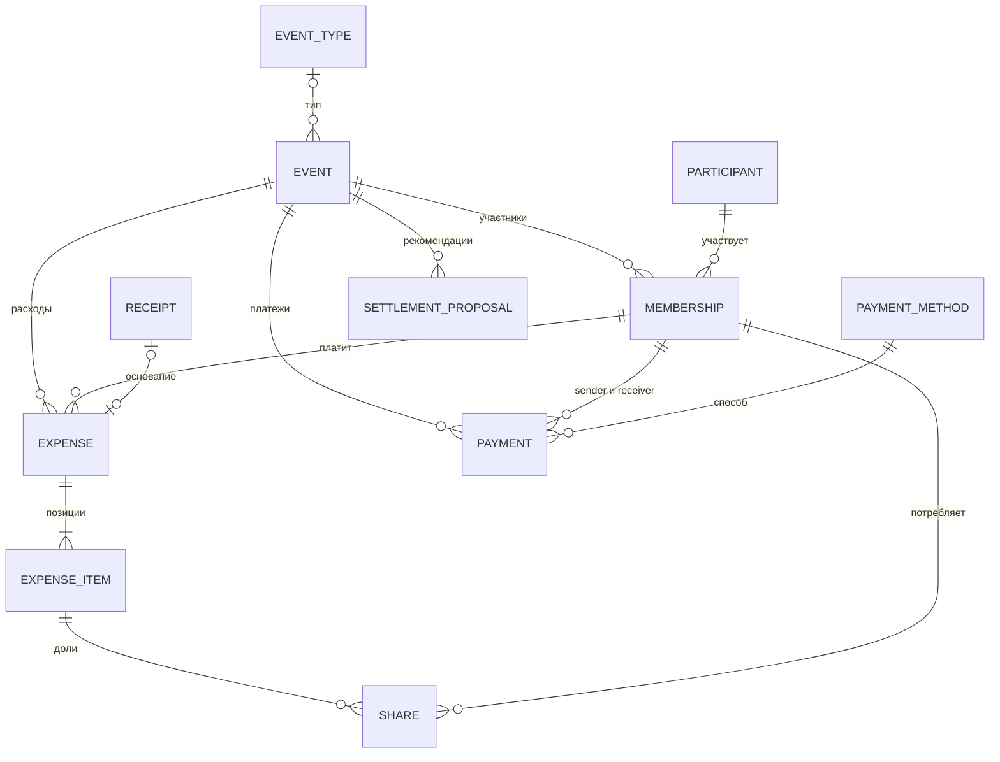

# Splitz: модель данных для Ontobox (Phlox)

| | |
|---|---|
| Проект | Splitz: учёт общих расходов и взаиморасчётов внутри «События» |
| Платформа | Ontobox, дизайнер моделей Phlox |
| Версия | 0.1, 19.10.2026, на согласование |
| Участники | Соловьёв Даниил Дмитриевич, Буздыган Мария Викторовна, Басманов Семён Сергеевич (группа 2462) |

---

## 0. Как читать документ

Источник по платформе: Д.Э. Гаврилина, «Дизайнер объектных онтологий Phlox», Иркутск, 2024, 83 с. (файл `BookPhlox_Mini.pdf`). Ссылки вида **[Phlox §4.6.1, с. 26–27]** означают раздел и страницы этой книги.

Каждое решение помечено одной из трёх меток:

| Метка | Значение |
|---|---|
| **[Док]** | Возможность прямо описана в книге, ссылка приведена |
| **[Реш]** | Проектное решение команды. В книге не описано, но ей не противоречит |
| **[Пров]** | Зависит от возможностей платформы, которых в книге нет. Нужно проверить на прототипе или спросить у преподавателя |

---

## 1. Границы проекта

**В MVP входит:**

- события с участниками;
- расходы двух видов: ручной ввод и импорт по QR-коду чека;
- раскладка позиций расхода по участникам (поровну или по весам);
- платежи с датой и способом оплаты (наличные / перевод), с подтверждением получателем;
- баланс каждого участника и рекомендуемые переводы для закрытия долгов;
- отчёт «Взаиморасчёты по событию».

**Не входит:** несколько валют, регулярные платежи, уведомления, онлайн-оплата, авторизация и права доступа (см. раздел 14, вопрос 3).

---

## 2. Архитектура



Что на какой стороне:

| Задача | Где выполняется | Основание |
|---|---|---|
| Хранение данных, статусы, методы, отчёты | Ontobox | **[Док]** Phlox Введение, с. 6–8; гл. 1, с. 9–11 |
| Сканирование QR и запрос к proverkacheka.com | Внешний клиент | **[Реш]** см. ниже |
| Передача результата в модель | Web API Ontobox | **[Док]** Phlox гл. 1, п. 4, с. 9; с. 10 |

Почему запрос к proverkacheka.com вынесен во внешний клиент. В книге сказано, что модели Ontobox доступны через Web API и над ними можно строить внешний front-end **[Док]** [Phlox гл. 1, с. 9–10]. Там же упомянуто, что методы могут «привязываться к мессенджерам, интернету вещей и другим источникам информации» **[Док]** [Phlox Введение, с. 8], но способ исходящего HTTP-запроса из метода на Libretto нигде не описан **[Пров]**. Поэтому исходящий запрос делает клиент, а в модель данные попадают через описанный в книге Web API.

Ограничение: сама спецификация Web API (адреса, формат запросов, авторизация) в книге не приведена, только факт его существования **[Пров]**.

Исполнение методов: код методов (язык Libretto) компилируется в библиотеку Librun и далее в байт-код JVM **[Док]** [Phlox §6, с. 34–35]. Это значит, что алгоритмы вроде раскладки копеек или расчёта переводов можно писать обычным кодом, а не только декларативно.

---

## 3. Соглашения моделирования

| Соглашение | Решение | Основание |
|---|---|---|
| Идентификаторы | `name` латиницей, читаемое имя `title` по-русски. Для пакета есть ещё `comments` и `alias` | **[Док]** Phlox §3.1, с. 15; §4.1, с. 19–20 |
| Деньги | Целое число копеек. Точная арифметика, остаток от деления отдаётся первой доле | **[Реш]**. Типы «целое» и «вещественное» есть **[Док]** [Phlox §7.2, с. 43] |
| Связь «ребёнок → родитель» | Поле-ссылка на документ родителя с опциями `Required` и `Inverse Cascade` | **[Док]** опции описаны в [Phlox §4.6.1, с. 26–27] |
| Производные значения | Поля формата `Function`, в базе не хранятся | **[Док]** формат `Function` в [Phlox §4.6.1, с. 24–26] |
| Справочники | Отдельные формы с документами (способ оплаты, тип события). Типа «перечисление» в списке типов полей нет | **[Док]** список типов в [Phlox §7.2, с. 43–44]; выбор справочников — **[Реш]** |
| Константы | Глобальные ключи на документах-справочниках | **[Док]** [Phlox §7.4, с. 44–46] |
| Значения по умолчанию | Для полей формы в книге не описаны. Заполняются методами и импортом. Значения по умолчанию есть у параметров методов и у статусов | **[Док]** [Phlox §6.7.3, с. 41]; [§5.4, с. 32] |
| Имя документа | Шаблон `#{...}` на форме, вычисляется в контексте документа | **[Док]** [Phlox §4.5, с. 23] |

Опции поля формы из книги **[Док]** [Phlox §4.6.1, с. 26–27]:

| Опция | Смысл |
|---|---|
| `Editable` | Разрешено ли редактирование |
| `Multi` | Поле может содержать несколько значений |
| `Required` | Значение обязательно |
| `Cascade` | Значения поля зависят от документа и удаляются вместе с ним |
| `Inverse Cascade` | При удалении документа удаляются те документы, у которых он указан в этом поле |
| `Inverse Single` | Выбранный документ может быть прикреплён только к одному документу |

---

## 4. Схема связей



Ключевое решение: плательщик, доли и платежи ссылаются не на человека, а на **Участие** (человек в конкретном событии). Тогда баланс естественно считается «в рамках события», а один человек может состоять в нескольких событиях. Связь «многие ко многим» между Событием и Участником раскрыта через ассоциативную форму `Membership` **[Реш]**.

Обратный доступ (от Расхода к его Позициям, от Позиции к Долям) нужен для полей `Function`. В интерфейсе Phlox обратные ссылки доступны («подгрузка инверсных документов») **[Док]** [Phlox §7.9.1, п. 6, с. 50]. Как это записывается в Libretto, в книге не показано **[Пров]**.

---

## 5. Пакеты

Формы объединяются в пакеты. У пакета есть идентификатор `name`, читаемое имя `title`, комментарии `comments` и короткое имя `alias` **[Док]** [Phlox §3.1, с. 15]. Для ссылок между пакетами в интерфейсе пакета есть управление `uses` **[Док]** [Phlox §3.4, п. 13, с. 18]; подробности настройки в книге не раскрыты **[Пров]**.

| `name` | `title` | Формы |
|---|---|---|
| `splitz_core` | Ядро | Participant, EventType, Event, Membership |
| `splitz_expenses` | Расходы | Receipt, Expense, ExpenseItem, Share |
| `splitz_settlement` | Взаиморасчёты | PaymentMethod, Payment, SettlementProposal |

Если `uses` окажется неудобным, все формы можно держать в одном пакете без потери функциональности **[Реш]**.

---

## 6. Формы

Во всех таблицах полей: «Формат» это `Standard` или `Function` **[Док]** [Phlox §4.6.1, с. 24–26]; типы значений взяты из списка **[Док]** [Phlox §7.2, с. 43–44]. Колонка «Опции» содержит только включённые опции. Деньги везде в копейках.

### 6.1 Participant (Участник), пакет `splitz_core`

Человек как таковой, не привязанный к событию. Один и тот же участник может входить в несколько событий.

Шаблон имени: `#{name}` **[Док]** [Phlox §4.5, с. 23].

| `name` | Тип | Формат | Опции | Назначение |
|---|---|---|---|---|
| `name` | строка | Standard | Required | Имя для отображения |
| `contact` | строка | Standard | | Телефон или telegram |

### 6.2 EventType (Тип события), пакет `splitz_core`, необязательный

Справочник для группировки в отчётах. Типа «перечисление» в платформе нет, поэтому справочник делается формой **[Реш]**.

| `name` | Тип | Формат | Опции | Назначение |
|---|---|---|---|---|
| `name` | строка | Standard | Required | Название типа |

Документы справочника: Поездка, Покупки, Жильё, Корпоратив, Подарок, Подписка, Другое.

### 6.3 Event (Событие), пакет `splitz_core`

Конкретный повод для трат со своим жизненным циклом.

Шаблон имени: `#{title}`.

| `name` | Тип | Формат | Опции | Назначение |
|---|---|---|---|---|
| `title` | строка | Standard | Required | Название |
| `type` | документ формы `EventType` | Standard | | Тип события |
| `description` | строка | Standard | | Описание |
| `startDate` | дата | Standard | | Начало |
| `endDate` | дата | Standard | | Окончание |
| `totalExpenses` | целое | Function | | Сумма учтённых расходов события |

**Статусы** **[Док]** [Phlox гл. 5, с. 29–33]: `open` «Открыто» (по умолчанию), `closed` «Закрыто».

**Методы:** `addMembers`, `calcSettlement`, `close` (см. раздел 9).

### 6.4 Membership (Участие), пакет `splitz_core`

Ассоциативная форма: «этот человек участвует в этом событии». На неё ссылаются плательщик, доли и платежи.

Шаблон имени (концептуально): имя участника, тире, название события. Точный синтаксис навигации внутри `#{...}` в книге не показан **[Пров]**.

| `name` | Тип | Формат | Опции | Назначение |
|---|---|---|---|---|
| `event` | документ формы `Event` | Standard | Required, Inverse Cascade | Событие. При удалении события участия удаляются |
| `participant` | документ формы `Participant` | Standard | Required | Человек |
| `paid` | целое | Function | | Сколько оплатил из своих средств |
| `consumed` | целое | Function | | Сумма его долей |
| `sent` | целое | Function | | Отдано по подтверждённым платежам |
| `received` | целое | Function | | Получено по подтверждённым платежам |
| `balance` | целое | Function | | Итоговый баланс (формула в разделе 10) |

Определения `Function`-полей (в терминах модели):

```
paid     = Σ Expense.amount     | Expense.payer = this, состояние расхода = «Учтён»
consumed = Σ Share.amount       | Share.member = this, расход позиции в состоянии «Учтён»
sent     = Σ Payment.amount     | Payment.sender = this, состояние = «Подтверждён»
received = Σ Payment.amount     | Payment.receiver = this, состояние = «Подтверждён»
balance  = paid − consumed + sent − received
```

Реализуемость полей `Function` через обратные ссылки в Libretto нужно подтвердить **[Пров]**. Запасной вариант: хранимые целые поля, которые пересчитывает метод.

### 6.5 Receipt (Чек), пакет `splitz_expenses`

Фискальный документ, из которого получен расход. Формат полей сверен со строкой QR-кода и формой на proverkacheka.com (подробности в разделе 7).

| `name` | Тип | Формат | Опции | Назначение |
|---|---|---|---|---|
| `qrRaw` | строка | Standard | | Строка QR целиком, как отсканирована |
| `t` | строка | Standard | | Дата и время как в QR: `20201017T1923` (допускается и вариант с секундами, см. §7) |
| `purchasedAt` | дата | Standard | | Дата покупки, разобранная из `t` |
| `s` | строка | Standard | | Сумма как в QR, в рублях: `1498.00` |
| `total` | целое | Standard | | Сумма в копейках: `149800` |
| `fn` | строка | Standard | | Номер фискального накопителя, 16 цифр |
| `i` | строка | Standard | | Номер фискального документа (ФД) |
| `fp` | строка | Standard | | Фискальный признак (ФП), до 10 цифр |
| `n` | целое | Standard | | Вид чека: 1 приход, 2 возврат прихода, 3 расход, 4 возврат расхода |
| `seller` | строка | Standard | | Продавец. В QR его нет, берётся из ответа сервиса проверки |
| `photo` | картинка | Standard | | Фото чека (необязательно) |
| `dedupKey` | строка | Function | | `fn` + «-» + `i` + «-» + `fp`, ключ для поиска дублей |

Почему `fn`, `i`, `fp` это строки, а не числа: чтобы не терять ведущие нули и не зависеть от разрядности целого **[Реш]**. Типы «строка», «целое», «дата», «картинка» есть в списке типов **[Док]** [Phlox §7.2, с. 43–44].

Форма хранит все шесть реквизитов (`t`, `s`, `fn`, `i`, `fp`, `n`), потому что форма проверки на proverkacheka.com запрашивает именно «ФН, ФД, ФП, Итог, Дата и Время, Вид чека» **[Реш]** по данным сайта.

**Методы:** `parseQr`, `isDuplicate`.

### 6.6 Expense (Расход), пакет `splitz_expenses`

Один факт оплаты: кто и когда заплатил. Состоит из позиций.

| `name` | Тип | Формат | Опции | Назначение |
|---|---|---|---|---|
| `event` | документ формы `Event` | Standard | Required, Inverse Cascade | Событие |
| `payer` | документ формы `Membership` | Standard | Required | Кто заплатил из своих средств |
| `title` | строка | Standard | Required | Что купили |
| `date` | дата | Standard | Required | Дата расхода |
| `receipt` | документ формы `Receipt` | Standard | Inverse Single | Основание. Один чек можно прикрепить только к одному расходу |
| `amount` | целое | Function | | Сумма позиций |

Опция `Inverse Single` описана в книге именно как запрет прикреплять один документ к нескольким **[Док]** [Phlox §4.6.1, п. 9, с. 27]. Она защищает от двойного учёта одного чека.

**Статусы:** `draft` «Черновик» (по умолчанию), `accounted` «Учтён».

**Методы:** `quickExpense` (на форме), `splitAllEqually`, `account`, `reopen`.

### 6.7 ExpenseItem (Позиция расхода), пакет `splitz_expenses`

Строка чека или одна сумма ручного расхода.

| `name` | Тип | Формат | Опции | Назначение |
|---|---|---|---|---|
| `expense` | документ формы `Expense` | Standard | Required, Inverse Cascade | Расход |
| `name` | строка | Standard | Required | Название товара |
| `quantity` | вещественное | Standard | | Количество (бывает дробным, например вес) |
| `sum` | целое | Standard | Required | Сумма позиции в копейках, как в чеке |
| `allocated` | целое | Function | | Сумма долей, для контроля полноты раскладки |

`sum` хранится как есть, а не вычисляется как цена × количество: в чеке сумма позиции уже округлена кассой **[Реш]**.

**Методы:** `splitEqually`, `distribute`.

### 6.8 Share (Доля), пакет `splitz_expenses`

Часть позиции, которую «потребил» один участник. Хранится отдельным документом, чтобы отчёты Phlox могли группировать и суммировать её без кода (аргумент «Analytics» по участнику и индикатор «Indicators» по сумме) **[Док]** [Phlox §10.3.1, с. 72].

| `name` | Тип | Формат | Опции | Назначение |
|---|---|---|---|---|
| `item` | документ формы `ExpenseItem` | Standard | Required, Inverse Cascade | Позиция |
| `member` | документ формы `Membership` | Standard | Required | Кто потребил |
| `weight` | вещественное | Standard | Required | Вес доли. Поровну это все веса 1 |
| `amount` | целое | Standard | | Сумма доли в копейках, считается методом `distribute` |

### 6.9 PaymentMethod (Способ оплаты), пакет `splitz_settlement`

Справочник. Два документа: «Наличные» и «Перевод».

| `name` | Тип | Формат | Опции | Назначение |
|---|---|---|---|---|
| `name` | строка | Standard | Required | Название |

Документам назначаются **глобальные ключи**, чтобы методы ссылались на них по константе **[Док]** [Phlox §7.4, с. 44–46]: `splitz.pm.cash` и `splitz.pm.transfer`. Имя ключа глобально на уровне модели, поэтому в книге рекомендуется выбирать имена без риска конфликтов [Phlox §7.4, с. 45]; отсюда префикс `splitz.`.

### 6.10 Payment (Платёж), пакет `splitz_settlement`

Передача денег между двумя участниками события.

| `name` | Тип | Формат | Опции | Назначение |
|---|---|---|---|---|
| `event` | документ формы `Event` | Standard | Required, Inverse Cascade | Событие |
| `sender` | документ формы `Membership` | Standard | Required | Кто отдал |
| `receiver` | документ формы `Membership` | Standard | Required | Кто получил |
| `amount` | целое | Standard | Required | Сумма в копейках |
| `date` | дата | Standard | Required | Дата платежа |
| `method` | документ формы `PaymentMethod` | Standard | Required | Наличные или перевод |
| `comment` | строка | Standard | | Комментарий |

**Статусы:** `pending` «Ожидает подтверждения» (по умолчанию), `confirmed` «Подтверждён», `rejected` «Отклонён».

**Методы:** `confirm`, `reject`.

### 6.11 SettlementProposal (Рекомендуемый перевод), пакет `splitz_settlement`, необязательная

Пересчитываемые данные: кому и сколько перевести, чтобы закрыть долги. Это кэш результата метода `calcSettlement`, а не первичные данные. При каждом пересчёте старые документы события удаляются **[Реш]**.

| `name` | Тип | Формат | Опции | Назначение |
|---|---|---|---|---|
| `event` | документ формы `Event` | Standard | Required, Inverse Cascade | Событие |
| `sender` | документ формы `Membership` | Standard | Required | Кто должен перевести |
| `receiver` | документ формы `Membership` | Standard | Required | Кому |
| `amount` | целое | Standard | Required | Сумма в копейках |

**Методы:** `makePayment`.

---

## 7. Проверка формата данных чека

Проверяемая строка (пример с главной страницы proverkacheka.com):

```
t=20201017T1923&s=1498.00&fn=9282440300669857&i=25151&fp=1186123459&n=1
```

### 7.1 Разбор параметров

| Параметр | Значение в примере | Что означает | Как хранится в `Receipt` | Результат проверки |
|---|---|---|---|---|
| `t` | `20201017T1923` | 17.10.2020, 19:23, формат `ГГГГММДДTЧЧММ` | `t` (строка как есть) и `purchasedAt` (дата) | Формат верный. В ранней версии модели `t` был типом «дата» и терял время, исправлено |
| `s` | `1498.00` | Сумма **в рублях** с десятичной точкой: 1498 руб. 00 коп. | `s` (строка как есть) и `total` = `149800` (копейки) | В ранней версии модели `s` считался целым числом копеек. Прямое сохранение дало бы 1498 вместо 149800. Исправлено: нужно преобразование |
| `fn` | `9282440300669857` | Номер фискального накопителя | `fn`, строка | 16 цифр, формат верный |
| `i` | `25151` | Номер фискального документа (ФД) | `i`, строка | Верно |
| `fp` | `1186123459` | Фискальный признак документа (ФП) | `fp`, строка | 10 цифр, формат верный |
| `n` | `1` | Вид чека: приход | `n`, целое | Верно, значение 1 |

Состав реквизитов QR-кода (дата и время расчёта, номер ФД, признак расчёта, сумма, номер ФН, ФП) закреплён в ст. 4.7 Федерального закона № 54-ФЗ. Это соответствует шести параметрам строки.

Значения `n`: форма проверки на proverkacheka.com предлагает «Приход, Возврат прихода, Расход, Возврат расхода». Это соответствует кодам 1, 2, 3, 4 стандартного реквизита «признак расчёта». Числовые коды желательно сверить со «Справкой» API **[Пров]**.

### 7.2 Правила разбора (`parseQr`)

1. Обрезать пробелы по краям. Разбить строку по `&` на пары, каждую пару разбить по первому `=`. Неизвестные ключи игнорировать.
2. Обязательные ключи: `t`, `s`, `fn`, `i`, `fp`. Если нет `n`, не подставлять значение молча, а запросить у пользователя.
3. `t`: допускать два формата, `^\d{8}T\d{4}$` и `^\d{8}T\d{6}$`. Первый встречается в примере proverkacheka.com. Второй (с секундами) встречается в публичном примере генерации QR (Infostart), поэтому парсер принимает оба.
4. `s`: заменить запятую на точку, проверить `^\d+(\.\d{1,2})?$`. Перевод в копейки **без вещественной арифметики**: целая часть × 100 + дробная часть, дополненная справа нулями до двух знаков. `1498.00` → `149800`, `1498` → `149800`, `1498.5` → `149850`.
5. `fn`: `^\d{16}$`. `i`: `^\d+$`. `fp`: `^\d{1,10}$`. `n`: одно из 1, 2, 3, 4.
6. Вычислить `dedupKey` и найти существующий `Receipt` с таким ключом. Если найден, новый не создавать, а вернуть существующий.
7. В MVP принимать только `n = 1` (приход). Возвраты (2, 4) и расход (3) отклонять с понятным сообщением **[Реш]**.

Контрольные случаи:

| Вход | Ожидание |
|---|---|
| Пример из раздела 7 | `total = 149800`, `purchasedAt = 2020-10-17`, `n = 1` |
| `t=20201017T192305` | Принимается, секунды отбрасываются или сохраняются в `t` |
| `s=1498` | `total = 149800` |
| `s=1498,5` | `total = 149850` |
| Нет `fp` | Ошибка «не хватает реквизита fp» |
| `n=2` | Отклонён: возврат в MVP не поддерживается |
| Повторная загрузка того же чека | Возвращается существующий `Receipt`, новый не создаётся |

Где выполняется разбор: основной вариант во внешнем клиенте (раздел 12). Метод `Receipt.parseQr` дублирует проверку внутри модели, если в Libretto доступны строковые операции. В книге они не описаны **[Пров]**.

### 7.3 Что подтверждено про proverkacheka.com, а что нет

Проверено по открытым страницам сайта на 19.10.2026:

| Факт | Источник |
|---|---|
| Главная страница принимает «Строку QR-кода» и показывает пример в том же формате, что проверяемая строка | https://proverkacheka.com |
| Ручной ввод по реквизитам: «ФН, ФД, ФП, Итог, Дата и Время, Вид чека» (Приход, Возврат прихода, Расход, Возврат расхода) | https://proverkacheka.com |
| Есть API получения чека по ключу-токену, а также отдельное API распознавания QR из изображения или PDF | https://proverkacheka.com/uslugi-a9 (услуги 3 и 4) |
| Токен и документация с примерами выдаются в личном кабинете, раздел «Справка» | https://proverkacheka.com/uslugi-a9 |

**Не подтверждено** (документация API закрыта личным кабинетом и недоступна без регистрации):

- адрес эндпоинта и названия параметров запроса; в ранних набросках проекта приводились `POST /api/v1/check/get` и параметр `qrraw`, это по памяти, не проверено;
- формат JSON-ответа и единицы сумм (копейки или рубли);
- лимиты бесплатного доступа и стоимость; ранее упоминавшийся лимит в 15 запросов в сутки не подтверждён;
- условия использования API в учебном проекте.

Как проверить: зарегистрироваться, сгенерировать токен, открыть «Справку», выполнить запрос с примером из раздела 7 и сверить сумму позиций ответа с `total = 149800`. До этого шага интеграцию с сервисом считать рабочей гипотезой **[Пров]**.

---

## 8. Статусы

Статусы фиксируют жизненный цикл документов формы **[Док]** [Phlox гл. 5, с. 29]. Статус по умолчанию присваивается новым документам **[Док]** [Phlox §5.4, с. 32]. Отображение статуса в таблице включается настройкой **[Док]** [Phlox §5.5, с. 32]. Ручная смена статуса выполняется в колонке состояния **[Док]** [Phlox §5.6, с. 33].

| Форма | Статусы (первый по умолчанию) | Переходы |
|---|---|---|
| Event | `open` Открыто, `closed` Закрыто | `open` → `closed` методом `close` |
| Expense | `draft` Черновик, `accounted` Учтён | `draft` → `accounted` методом `account`; обратно методом `reopen` |
| Payment | `pending` Ожидает подтверждения, `confirmed` Подтверждён, `rejected` Отклонён | `pending` → `confirmed` методом `confirm`; `pending` → `rejected` методом `reject`; из конечных состояний возврата нет |
| Receipt, ExpenseItem, Share, остальные | не используются | |

В баланс попадают только расходы в состоянии `accounted` и платежи в состоянии `confirmed`.

**Ограничение.** В книге описана только ручная смена статуса **[Док]**. Может ли метод менять статус документа, не сказано **[Пров]**. Если не может, методы `account`, `confirm`, `close` только проверяют условия и возвращают результат, а статус пользователь переключает вручную после успешной проверки.

---

## 9. Методы

Общие сведения о методах платформы:

| Возможность | Основание |
|---|---|
| Метод определяется на форме, применяется к документам формы; кодируется только тело, сигнатура задаётся декларативно | **[Док]** [Phlox гл. 6, с. 33] |
| Контекст метода: документ или форма документа | **[Док]** [Phlox §6.1, п. 4, с. 35] |
| У параметров есть кардинальность (`Multi`, `Required`) | **[Док]** [Phlox §6.7.1, с. 39] |
| Атрибуты параметра: `Domain` (допустимые значения), `Default`, `Display condition` | **[Док]** [Phlox §6.7.3, с. 41] |
| Тип результата задаётся явно, с кардинальностью | **[Док]** [Phlox §6.3, с. 37–38] |
| Вызов из таблицы, с параметрами и без | **[Док]** [Phlox §7.6–7.7, с. 47–48] |
| Групповой вызов метода для выбранных документов | **[Док]** [Phlox §7.8, с. 49–50] |
| Несколько операций можно объединить в одной транзакции | **[Док]** [Phlox Введение, с. 8] |

### 9.1 Сигнатуры

| Форма | Метод | Контекст | Параметры | Результат |
|---|---|---|---|---|
| Event | `addMembers` | документ | `participants`: Participant, Multi, Required. Domain: участники, ещё не входящие в событие | Membership, Multi |
| Event | `calcSettlement` | документ | нет | SettlementProposal, Multi |
| Event | `close` | документ | нет | строка (итог проверки) |
| Expense | `quickExpense` | форма | `event`: Event, Required. `payer`: Membership, Required, Domain: участники `event`. `title`: строка, Required. `date`: дата, Required, Default: сегодня. `sum`: целое, Required. `consumers`: Membership, Multi, Required, Domain: участники `event` | Expense |
| Expense | `splitAllEqually` | документ | `members`: Membership, Multi, Required, Domain: участники события расхода | нет |
| Expense | `account` | документ | нет | строка (итог проверки) |
| Expense | `reopen` | документ | нет | нет |
| ExpenseItem | `splitEqually` | документ | `members`: Membership, Multi, Required, Domain: участники события расхода | нет |
| ExpenseItem | `distribute` | документ | нет | нет |
| Payment | `confirm` | документ | нет | строка (итог проверки) |
| Payment | `reject` | документ | `comment`: строка | нет |
| SettlementProposal | `makePayment` | документ | `method`: PaymentMethod, Required, Default: документ с ключом `splitz.pm.transfer`. `date`: дата, Required, Default: сегодня | Payment |
| Receipt | `parseQr` | документ | `qrRaw`: строка, Required | строка (ошибки или «ок») |
| Receipt | `isDuplicate` | документ | нет | Receipt (не обязательно) |

### 9.2 Алгоритмы (язык-независимое описание)

Синтаксис Libretto в книге не приведён, поэтому ниже логика, а не код. Код пишется после согласования модели.

**`ExpenseItem.distribute`**

```
вход: S = item.sum (копейки), доли sh[1..k] с весами w[1..k] > 0
W = Σ w
base[j] = floor(S * w[j] / W)            // целочисленно
rest = S − Σ base
первым rest долям (по порядку создания) прибавить по 1 копейке
sh[j].amount = base[j] (+1)
инвариант: Σ sh.amount = S
```

**`ExpenseItem.splitEqually(members)`**

```
удалить существующие доли позиции
для каждого m из members: создать Share(item, member=m, weight=1)
вызвать distribute
```

**`Expense.account`**

```
проверить:
  есть хотя бы одна позиция
  payer входит в участников события
  для каждой позиции: есть доли; все member входят в участников события;
                      Σ share.amount = item.sum
если есть нарушения: вернуть их список, статус не менять
иначе: статус := accounted (или инструкция пользователю, см. раздел 8)
```

**`Expense.quickExpense`** (одна транзакция)

```
создать Expense(event, payer, title, date), статус draft
создать ExpenseItem(expense, name = title, sum = sum, quantity = 1)
вызвать splitEqually(consumers)
вызвать account
вернуть Expense
```

**`Payment.confirm`**

```
проверить: статус pending; sender ≠ receiver; amount > 0;
           sender и receiver входят в участников события; событие открыто
если нарушения: вернуть список
иначе: статус := confirmed
```

**`Event.calcSettlement`**

```
удалить SettlementProposal события
b[m] = Membership.balance для каждого участия события
пока есть b < 0 и b > 0:
    d = участие с наименьшим b          // самый большой должник
    c = участие с наибольшим b          // самый большой кредитор
    x = min(−b[d], b[c])
    создать SettlementProposal(event, sender = d, receiver = c, amount = x)
    b[d] += x; b[c] −= x
вернуть созданные предложения
```

Жадный алгоритм даёт не более n−1 переводов для n участников: каждый шаг обнуляет баланс хотя бы одного участника, а последний шаг обнуляет двух. Задача о *строго* минимальном числе переводов NP-трудна, поэтому в описании проекта корректнее говорить «сокращённое число переводов», а не «минимальное». Учитываются только подтверждённые платежи. Если есть платежи в ожидании, метод предупреждает об этом.

**`Event.close`**

```
проверить: нет расходов в статусе draft; нет платежей в статусе pending;
           у всех участий balance = 0
если нарушения: вернуть список
иначе: статус := closed
```

**`SettlementProposal.makePayment(method, date)`**

```
создать Payment(event, sender, receiver, amount, method, date), статус pending
вернуть Payment
```

Метод `ExpenseItem.distribute` без параметров удобно запускать групповым вызовом для выбранных позиций **[Док]** [Phlox §7.8, с. 49–50].

---

## 10. Баланс, инварианты, пример

### 10.1 Формула

```
balance(m) =  Σ расходов, где m плательщик (Учтён)
            − Σ долей m (по учтённым расходам)
            + Σ платежей, где m sender   (Подтверждён)
            − Σ платежей, где m receiver (Подтверждён)
```

Плюс означает «ему должны», минус означает «он должен». Проверка знаков: участник оплатил 300 за ужин на троих (по 100). Его баланс 300 − 100 = +200, у двух других по −100. Если один из них отдаёт 100, у него −100 + 100 = 0, у плательщика +200 − 100 = +100. Сумма по событию остаётся равной нулю.

### 10.2 Инварианты

| № | Инвариант |
|---|---|
| I1 | Сумма `balance` по всем участиям события равна 0 |
| I2 | У учтённого расхода сумма долей каждой позиции равна `sum` позиции |
| I3 | Плательщик и все участники долей входят в событие расхода |
| I4 | У платежа `sender` ≠ `receiver`, `amount` > 0, оба входят в событие |
| I5 | В закрытом событии нет черновиков и ожидающих платежей, все балансы нулевые |
| I6 | Один чек привязан не более чем к одному расходу (`Inverse Single`) |
| I7 | `dedupKey` чека уникален |

Декларативных ограничений такого рода в книге не описано, поэтому I2–I5 проверяются методами `account`, `confirm`, `close`, а I6 обеспечивает опция поля **[Реш]**. Прямое редактирование таблиц в обход методов инварианты нарушить может; договорённость: учтённые расходы правятся только после `reopen`.

### 10.3 Пример

Событие «Выходные в горах», участия: Алексей (А), Борис (Б), Вера (В). Чек из примера `s=1498.00`, то есть 149800 коп. Позиции условные, плательщик А.

| Позиция | Сумма, коп. | Кто потребил | Доли |
|---|---|---|---|
| Шашлык | 90000 | А, Б, В | 30000 / 30000 / 30000 |
| Вода | 19800 | А, Б | 9900 / 9900 |
| Уголь | 40000 | А, Б, В | 13334 / 13333 / 13333 (копейка остатка первому) |

Потреблено: А 53234, Б 53233, В 43333; сумма 149800, инвариант I2 выполнен.

| Участник | paid | consumed | balance |
|---|---|---|---|
| А | 149800 | 53234 | +96566 |
| Б | 0 | 53233 | −53233 |
| В | 0 | 43333 | −43333 |
| Сумма | | | 0 |

`calcSettlement` создаёт два предложения (n−1): Б → А 53233, В → А 43333.

Борис оформляет платёж Б → А на 53233 способом «Перевод» и дату. Алексей подтверждает. Новые балансы: А +43333, Б 0, В −43333. Пересчёт даёт одно предложение: В → А 43333.

---

## 11. Запросы и отчёты

### 11.1 Запросы (Selections)

Запрос хранит выборку документов, написанную на навигационном языке запросов к объектным моделям **[Док]** [Phlox гл. 9, с. 60]. Колонки запроса бывают двух форматов: «Model Field» (поле формы) и «Pseudo Field» (вычисляемое выражение) **[Док]** [Phlox §9.5.1, с. 64]. Синтаксис языка запросов в книге не приведён **[Пров]**.

| Запрос | Выборка | Зачем |
|---|---|---|
| Платежи в ожидании | Payment в статусе `pending` | Получатель видит, что нужно подтвердить |
| Черновики расходов | Expense в статусе `draft` | Контроль перед закрытием события |
| Чеки без расхода | Receipt, не привязанные ни к одному Expense | Находить «осиротевшие» результаты импорта |

### 11.2 Отчёт «Взаиморасчёты по событию»

Отчёт собирается из аргументов, узлов сборки данных и структуры **[Док]** [Phlox гл. 10, с. 67–77].

| Элемент отчёта | Настройка | Основание |
|---|---|---|
| Аргументы типа Analytics (по ним группируют) | «Событие», «Участник» | **[Док]** [Phlox §10.3.1, с. 72] |
| Аргументы типа Indicators (накопители сумм) | «Оплачено» (`paid`), «Потреблено» (`consumed`), «Отправлено» (`sent`), «Получено» (`received`), «Баланс» (`balance`) | **[Док]** [Phlox §10.3.1, с. 72] |
| Узел сборки данных | Запрос по всем `Membership` | **[Док]** [Phlox §10.3.2, с. 73–74] |
| Для Analytics заполняются | `Value`, `Title`, `Order` | **[Док]** [Phlox §10.3.2, с. 74] |
| Для Indicators заполняется | `Value` | **[Док]** [Phlox §10.3.2, с. 75] |
| Структура | По вертикали: «Событие», «Участник». Индикаторы: все пять | **[Док]** [Phlox §10.3.3, с. 75–76] |

Фильтра по одному событию в описании отчётов нет **[Пров]**. Поэтому «Событие» ставится первой вертикальной аналитикой: данные группируются по событиям, и нужное событие видно отдельным блоком.

Необязательный второй отчёт «Расходы по типам событий»: аналитика `EventType`, индикатор `totalExpenses`.

---

## 12. Импорт чека: пошаговый сценарий

| Шаг | Где | Действие |
|---|---|---|
| 1 | Клиент | Пользователь сканирует QR или вставляет строку |
| 2 | Клиент | Строка разбирается и проверяется по правилам раздела 7.2 |
| 3 | Клиент | Поиск `Receipt` с тем же `dedupKey` через Web API. Если найден, расход не создаётся повторно **[Пров]** |
| 4 | Клиент | Запрос к proverkacheka.com по токену, получение позиций и продавца (раздел 7.3 **[Пров]**) |
| 5 | Клиент | Сверка: сумма позиций должна совпасть с `total`. При расхождении предупреждение |
| 6 | Клиент → Ontobox | Создание через Web API: `Receipt`, затем `Expense` (статус `draft`, ссылки на событие, плательщика, чек), затем `ExpenseItem` по числу позиций **[Док]** Web API: [Phlox с. 9–10] |
| 7 | Ontobox (Phlox) | Пользователь раскладывает позиции: `splitEqually` или вручную по весам, затем `distribute` |
| 8 | Ontobox | `account` переводит расход в «Учтён» |

Запасной путь, если чек не найден сервисом или QR не читается: ручной расход через `quickExpense`. Расход не зависит от наличия чека **[Реш]**.

---

## 13. Матрица «решение → документация»

| № | Решение | Где описано | Метка |
|---|---|---|---|
| 1 | Модель как набор форм с табличным интерфейсом, низкий код | Phlox Введение, с. 6–8 | Док |
| 2 | Доступ к модели через Web API, внешний front-end | Phlox гл. 1, п. 4, с. 9; с. 10 | Док |
| 3 | Исходящий HTTP из метода Libretto | в книге нет | Пров |
| 4 | Пакеты: `name`, `title`, `comments`, `alias` | Phlox §3.1, с. 15 | Док |
| 5 | Связи между пакетами через `uses` | Phlox §3.4, п. 13, с. 18 | Док (подробности Пров) |
| 6 | Создание формы | Phlox §4.1, с. 19–20 | Док |
| 7 | Шаблон имени документа `#{...}` | Phlox §4.5, с. 23 | Док |
| 8 | Поля формата Standard и Function | Phlox §4.6.1, с. 24–26 | Док |
| 9 | Опции `Editable`, `Multi`, `Required` | Phlox §4.6.1, с. 26 | Док |
| 10 | Опции `Cascade`, `Inverse Cascade`, `Inverse Single` | Phlox §4.6.1, с. 26–27 | Док |
| 11 | Типы полей: целое, вещественное, строка, дата, документ формы, файл, картинка, функция | Phlox §7.2, с. 43–44 | Док |
| 12 | Справочники-формы вместо перечислений | список типов, с. 43–44 | Реш |
| 13 | Значения по умолчанию для полей формы | в книге нет (есть для статусов и параметров) | Пров |
| 14 | Статусы, статус по умолчанию, ручная смена | Phlox гл. 5, с. 29–33; §5.4, с. 32; §5.6, с. 33 | Док |
| 15 | Смена статуса из метода | в книге нет | Пров |
| 16 | Методы на форме, контекст документ или форма | Phlox гл. 6, с. 33; §6.1, с. 35 | Док |
| 17 | Параметры метода, `Multi`, `Required` | Phlox §6.7.1, с. 39 | Док |
| 18 | `Domain`, `Default`, `Display condition` параметров | Phlox §6.7.3, с. 41 | Док |
| 19 | Тип результата метода | Phlox §6.3, с. 37–38 | Док |
| 20 | Код метода на Libretto, исполнение как JVM-байт-код | Phlox §6.4, с. 38; с. 34–35 | Док |
| 21 | Несколько операций в одной транзакции | Phlox Введение, с. 8 | Док |
| 22 | Вызов метода из таблицы, с параметрами и без | Phlox §7.6–7.7, с. 47–48 | Док |
| 23 | Групповой вызов метода | Phlox §7.8, с. 49–50 | Док |
| 24 | Глобальные ключи документов | Phlox §7.4, с. 44–46 | Док |
| 25 | Обратные ссылки в интерфейсе | Phlox §7.9.1, п. 6, с. 50 | Док (в Libretto Пров) |
| 26 | Создание документа «по месту» | Phlox §7.9.2, с. 51 | Док |
| 27 | Древовидное управление метаобъектами, копирование форм и полей | Phlox гл. 8, с. 52–58 | Док |
| 28 | Запросы, колонки Model Field и Pseudo Field | Phlox гл. 9, с. 60–67; §9.5.1, с. 64 | Док |
| 29 | Отчёты: аргументы, узлы, структура | Phlox гл. 10, с. 67–77 | Док |
| 30 | Деньги в копейках, доли отдельными документами, форма Участие | | Реш |
| 31 | Импорт чека во внешнем клиенте | | Реш |

---

## 14. Открытые вопросы и риски

| № | Вопрос | Почему важно | Запасной вариант |
|---|---|---|---|
| 1 | Может ли метод менять статус документа? | От этого зависит автоматизация `account`, `confirm`, `close` | Методы только проверяют, статус переключается вручную |
| 2 | Как в Libretto суммировать по обратным ссылкам? | На этом построены поля `Function` (`amount`, `balance` и др.) | Хранимые поля, которые обновляют методы |
| 3 | Как узнать текущего пользователя? | Без этого «подтверждает получатель» остаётся договорённостью, права не проверяются | Подтверждение вручную, кем именно выбирается в параметре |
| 4 | Есть ли значения по умолчанию у полей формы? | Для `quantity` и `weight` | Заполнять методами и клиентом |
| 5 | Хранит ли тип «дата» время? | Для `Receipt.t` | `t` хранится строкой, дата отдельно |
| 6 | Есть ли параметры у запросов и фильтр отчёта по событию? | Удобство работы с несколькими событиями | Группировка по событию в отчёте |
| 7 | Есть ли в Libretto строковые операции? | Для `parseQr` внутри модели | Разбор только в клиенте |
| 8 | Как устроен Web API Ontobox: адреса, авторизация, создание документов? | На нём держится импорт чеков | Уточнить у преподавателя до начала клиента |
| 9 | Условия, лимиты и формат ответа API proverkacheka.com | Раздел 7.3 | Регистрация и проверка по «Справке»; запасной путь: ручной ввод |
| 10 | Название Splitz совпадает с существующим приложением «Splitz: Track & Split Expenses» | Вопрос об аналогах на защите | Использовать как конкурента в бизнес-части |

Основной технический риск: зависимость от стороннего сервиса proverkacheka.com. Ядро проекта (события, расходы, доли, платежи, балансы) от него не зависит и работает при ручном вводе.

---

## 15. Источники

1. Д.Э. Гаврилина. Дизайнер объектных онтологий Phlox. Иркутск: Изд-во Ирк. гос. пед. ун-та, 2024. 83 с. (файл `BookPhlox_Mini.pdf`).
2. Проверка чека онлайн, главная страница с формой и примером строки QR: https://proverkacheka.com (просмотрено 19.10.2026).
3. Проверка чека онлайн, раздел «Услуги» (API по токену, документация в личном кабинете): https://proverkacheka.com/uslugi-a9 (просмотрено 19.10.2026).
4. Состав реквизитов QR-кода по ст. 4.7 Федерального закона № 54-ФЗ: https://www.nalog.gov.ru/rn68/news/smi/9441211/ и https://buh.ru/news/uchet_nalogi/70642/.
5. Пример генерации строки QR (в нём время формируется с секундами): https://infostart.ru/1c/tools/655815 (страница видна в результатах поиска; при открытии сайт блокирует автоматические запросы, поэтому опора на фрагмент выдачи).
